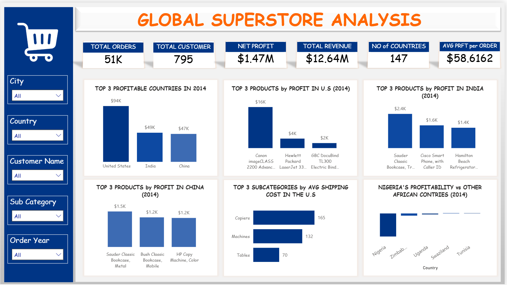
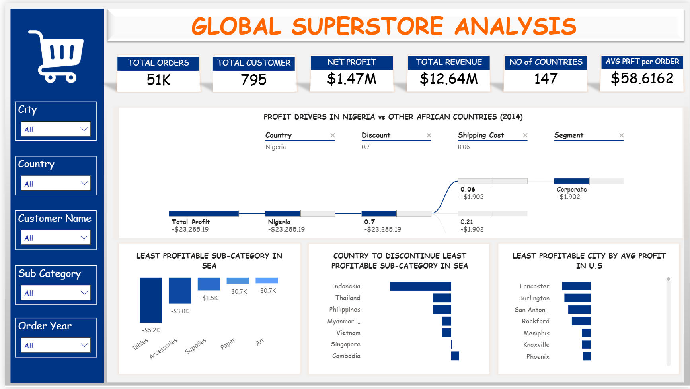
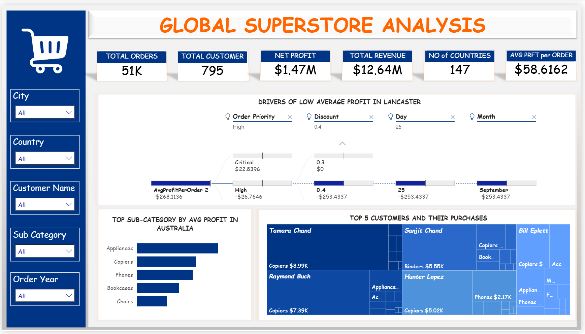
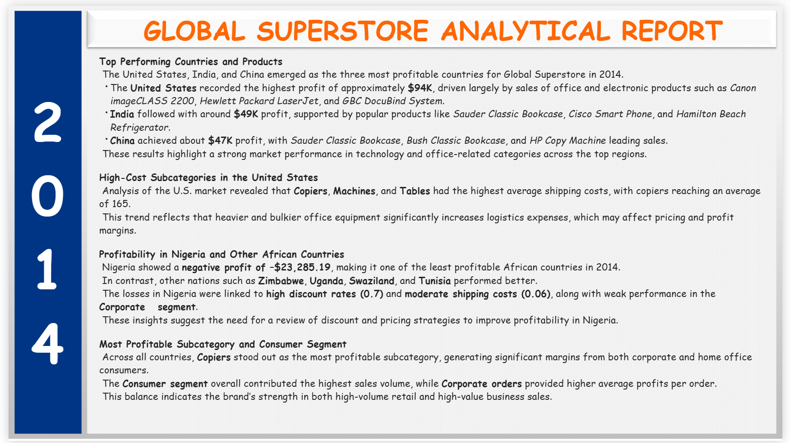
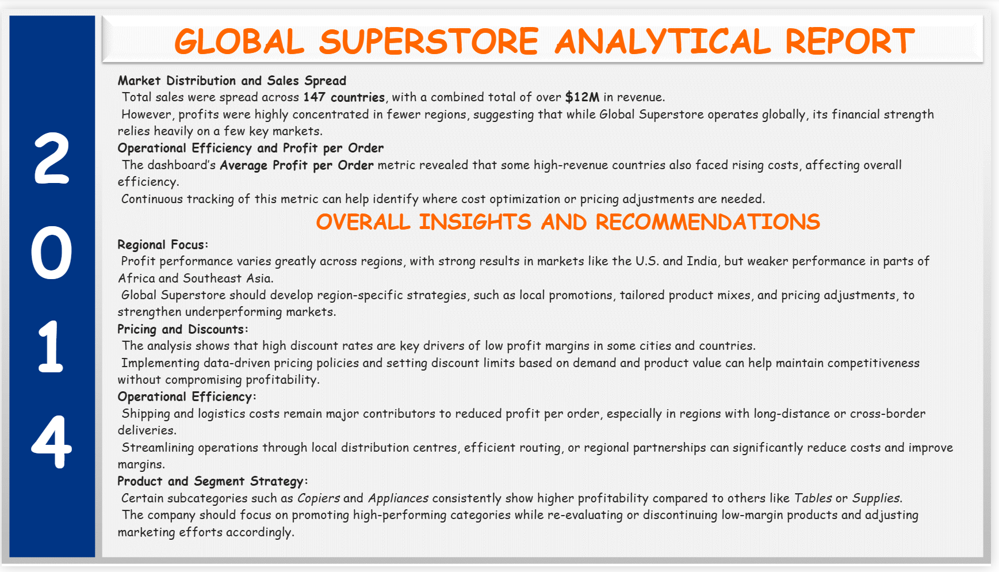

# 📊 GLOBAL SUPERSTORE ANALYSIS

---

## 🏢 Introduction

**Global Superstore** is a global online retailer headquartered in **New York**, offering a broad product catalog to customers across **147 countries**.

The company lists over **10,000 products** across three main categories: **Office Supplies**, **Furniture**, and **Technology**.  

As a Data Analyst, I was contracted to analyze the Superstore’s dataset to uncover insights that would help management make informed decisions aimed at improving performance, profitability, and customer satisfaction.

---

## 📁 Project Overview

This project analyzes the Global Superstore dataset with a focus on profitability, shipping costs, discounts, and customer value. 

The goal is to identify high-performing countries and products, diagnose underperforming regions (with special attention to Nigeria and Southeast Asia), and surface opportunities for revenue growth and cost savings.

Key objectives:
- Identify top profit-generating countries and products (2014).
- Find subcategories with the highest shipping costs (U.S.).
- Evaluate Nigeria’s profitability and root causes of underperformance.
- Identify the least profitable subcategory in Southeast Asia and whether any country should stop offering it.
- Find the least profitable U.S. city (avg. profit per order, with ≥10 orders).
- Determine the highest-average-profit product subcategory in Australia.
- Identify the most valuable customers and their purchase patterns.

---

## 🧰 Tools & Technologies

- **Power BI** — interactive dashboards and visuals  
- **Power Query** — data cleaning and transformation  
- **PowerPoint** — presentation & report export

---

## 🧠 Skills Demonstrated

- Data cleaning & transformation (Power Query)  
- DAX measures & modeling  
- Interactive data visualization (Power BI)  
- Analytical storytelling & insights documentation
- Data Annotation

---

## ✨ Key Features

- Country-level and product-level profitability analysis  
- Shipping cost and discount impact evaluation  
- Geographic hotspot identification (country / city / street-level)  
- Customer value segmentation and product affinity analysis  
- Actionable recommendations for operations, pricing, and product strategy

  ## 📸 Visualization Display

### **Profit & Shipping Overview**  
*Top countries by profit (2014), their top products, and U.S. subcategories with the highest shipping costs. Includes an initial assessment of Nigeria’s 2014 profitability.*

  

 ### **Regional Performance & Low-Profit Analysis**  
 *Deeper Nigeria comparison with other African countries, identification of least-profitable SEA subcategory, and city-level profitability in the U.S.*
 

 ### **Customer Value & Final Diagnostics**  
 *Least Profitable U.S. Cities (continued), Australia’s Highest Avg Profit Subcategory, & Top Customers and Their Purchases.*
 
 

 ## 🔎 Analysis & Recommendations Visuals
 ### Analytical Report
 

 ### Recommendations
 

 ## 🔎 Analysis & Insights (by objective)

### Top profit-generating countries & products (2014)
- The analysis identified the **three countries with the highest total profit** in 2014 (top countries appear in Dashboard 1).  
- For each top country, the **three most profitable products** were extracted these are typically high-margin technology and office equipment items.  
**Insight:** Profit concentration is high in a few countries and driven by specific high-margin products.

### Highest average shipping cost subcategories (U.S.)
- The U.S. subcategories with the **highest average shipping costs** were identified (Dashboard 1).  
**Insight:** Bulky/heavy categories (e.g., copiers, furniture pieces) drive shipping expenses and squeeze margins; these require targeted logistics optimization.

### Nigeria’s profitability and root causes (2014)
- **Nigeria recorded negative (or low) total profit** in 2014 relative to other African countries (Dashboards 1 & 2).  
- Key drivers include **high shipping costs** and **elevated discount rates** on certain items.  
**Insight:** Logistics and pricing policies are primary suspects; operational and pricing fixes could materially improve results.

### Least profitable subcategory in Southeast Asia & country-level action
- The **least profitable subcategory in Southeast Asia** was identified (Dashboard 2).  
- Country-level decomposition shows *particular countries* where that subcategory performs especially poorly — candidates for *reprioritization, withdrawal, or aggressive re-pricing*.  
**Insight:** Consider reducing SKU presence, adjusting pricing, or halting offerings where localized economics are unsustainable.

### Least profitable U.S. city (avg. profit per order, ≥10 orders) and reasons
- The least profitable U.S. city (filtered for ≥10 orders) was determined (Dashboards 2 & 3).  
- Drivers include **high discounting**, **low average order value**, and **high shipping per order** or returns.  
**Insight:** Tactical local pricing and promotional changes could remediate poor unit economics.

### Highest average profit subcategory in Australia
- Identified the **top subcategory by average profit** in Australia (Dashboard 3).  
**Insight:** These categories are candidates for allocation of marketing, premium placement, and prioritized stock.

### Most valuable customers and purchase patterns
- Top customers were identified by lifetime profit/contribution; their **purchase preferences** (categories/subcategories) were profiled (Dashboard 3).  
**Insight:** High-value customers heavily favor technology and office supplies — they are ideal targets for retention programs and upsell campaigns.

Full report: [Global Superstore Report (PDF)](CAPSTONE%20PROJECT%201%28GLOBALSUPER%20STORE%29%202.pdf) · Power BI file: [Global Superstore Analysis (.pbix)](CAPSTONE%20PROJECT%201%28GLOBALSUPER%20STORE%29%202.pbix)

 ## 🧭 Conclusion
 
 Global Superstore demonstrates strong performance across global markets, but profitability varies widely by region.  
 
 The analysis revealed key improvement areas such as shipping optimization, discount management, and product rationalization.  
 
 Overall, this data-driven assessment enables management to refine pricing, logistics, and marketing strategies across high- and low-performing markets.
 

 ## 🛠 Recommendations
 
- Optimize Shipping Operations: Review logistics partnerships in Africa and Southeast Asia to reduce delivery costs.

- Adjust Discount Policies: Implement a dynamic discounting strategy to prevent excessive markdowns in low-margin regions.

- Focus on High-Value Subcategories: Reinforce marketing and stock allocation for Technology products, especially Copiers and Phones.

- Customer Retention Programs: Strengthen relationships with top-performing customers through loyalty incentives and exclusive offers.

- Market Exit or Product Repositioning: Reconsider underperforming subcategories (like Tables in Southeast Asia) or reposition them with a niche strategy.
